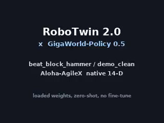

# GigaWorld-Policy-Sim2Real

Research workspace for reproducing GigaWorld-Policy 0.5, measuring action generation and inference latency, adapting policies to bimanual simulation, and documenting later sim-to-real work.



## Scope

- **M0–M1:** reproduce the official Python and C++ inference paths; save valid action chunks, latency, and peak memory.
- **M2:** evaluate a native RoboTwin task in closed loop.
- **M3:** adapt and fine-tune for the MuJoCo dual SO101 setup.
- **M4:** prepare real-robot deployment with explicit safety checks.
- **M5:** compare GWP, π0.5, and ACT under a shared protocol.

This repository contains experiment code, configurations, source pins, and reports. Model checkpoints, datasets, generated videos, environments, and caches live outside Git and are referenced through local environment variables.

## Status

Measured 2026-10-23 on a 4× RTX 4090 host. Each row links to the artifact that
supports it; the full mapping is in [`docs/experiments/evidence-index.md`](docs/experiments/evidence-index.md).

| Milestone | Result | Notes |
|---|---|---|
| M0/M1 — Python inference reproduction | **PASS** | `[48, 14]` finite chunk, model p50 674.9 ms, 13.98 GB peak reserved |
| M2 — native RoboTwin closed loop | **PASS (interface) / FAIL (task)** | Real policy actions drive the simulator; 0 of 3 seeds succeed |
| M2 — wam.cpp conversion and self-check | **PASS** | 23.51 GB GGUF, `wam-validate` reports `valid: true` |
| M2 — wam.cpp numeric parity | **BLOCKED** | `cudaMalloc` failed at ~21.9 GiB resident on a shared 24 GiB card; inputs staged, tooling ready |
| M3 — SO101 adaptation | not started | |
| M4 — real robot | not started | |
| M5 — cross-policy comparison | not started | |

### What these results do and do not establish

- The **interface** between a 14-D Aloha-AgileX simulation and GWP 0.5 works: observations map, actions are accepted, episodes reset, videos and traces are produced.
- The **zero-shot policy** does not solve `beat_block_hammer`. The commanded joint-1 target drifts from ~0.85 rad to ~44 rad across 50 chunks under two different normalization conventions. The available evidence is consistent with a policy/embodiment fit issue, but does not isolate that cause; fine-tuning is out of scope for M2.
- The **C++ path** has not produced an output in the recorded attempt: one 10,835 MiB allocation failed while about 21.9 GiB was already resident. This does not establish the full inference peak or that the hardware is categorically insufficient.

Expert replay and policy control are reported separately everywhere. A replay
proving the data is good is never evidence that the policy works.

## Repository map

```text
configs/environments/    task and embodiment records, derived requirements files
configs/experiments/     per-specification run parameters
configs/models/          checkpoint contract (dims, horizon, placement, memory)
docs/specifications/     stage acceptance criteria, with pass/fail per item
docs/experiments/        plans, results, reproduction commands, upstream pins
patch/                   local patches against upstream files, with originals identified by hash
scripts/setup/           environment builds, patching, adapter install
scripts/data/            collection, conversion, contract probes, statistics
scripts/infer/           GWP server, open-loop benchmark, wam.cpp conversion
scripts/evaluate/        simulator smoke, expert replay, closed loop
scripts/checks/          private-path gate, source baseline
src/gwp_sim2real/        contracts, inference client, RoboTwin adapter
tests/                   contract tests that run without a GPU or simulator
external/                instructions for separately installed upstream repos
```

## Quick start

```bash
cp .env.example .env          # fill in the paths on your machine
pip install -e ".[dev]"       # numpy + pytest; nothing GPU-side is needed for the tests
pytest -q                     # 16 contract tests, no simulator required
```

Then follow [`docs/experiments/robotwin-gwp-native-repro.md`](docs/experiments/robotwin-gwp-native-repro.md)
in order. Stage A is a gate: if the renderer does not produce non-constant
frames, nothing downstream is meaningful.

## Reading order

| Document | Why |
|---|---|
| [`docs/experiments/robotwin-gwp-native.md`](docs/experiments/robotwin-gwp-native.md) | The plan as written, and what actually happened |
| [`docs/experiments/robotwin-gwp-native-results.md`](docs/experiments/robotwin-gwp-native-results.md) | Every measured number, plus the defects that had to be fixed |
| [`docs/experiments/environment-lock.md`](docs/experiments/environment-lock.md) | Host, three environments, package locks, hazards |
| [`docs/experiments/upstream-sources.md`](docs/experiments/upstream-sources.md) | Source pins, license status, patch inventory |
| [`docs/specifications/`](docs/specifications/) | Acceptance criteria per stage |

## Conventions

- **Evidence classes.** Every claim is `measured`, `documented`, `inferred`, or
  `not verified`. A process starting is not a pass.
- **No private paths.** `python3 scripts/checks/no_private_paths.py` fails the
  commit if the *staged* content contains a home directory, a routable address,
  or SSH material. It reads the index, not the working tree. Everything
  machine-specific comes from `.env`.
- **Artifacts stay out.** Weights, datasets, videos, GGUF files, and caches are
  referenced through `$RUNS_DIR` / `$ARTIFACTS_DIR` and never committed.
- **Upstream stays intact.** Third-party trees live outside this repository; the
  only local modifications are the diffs in `patch/`.
